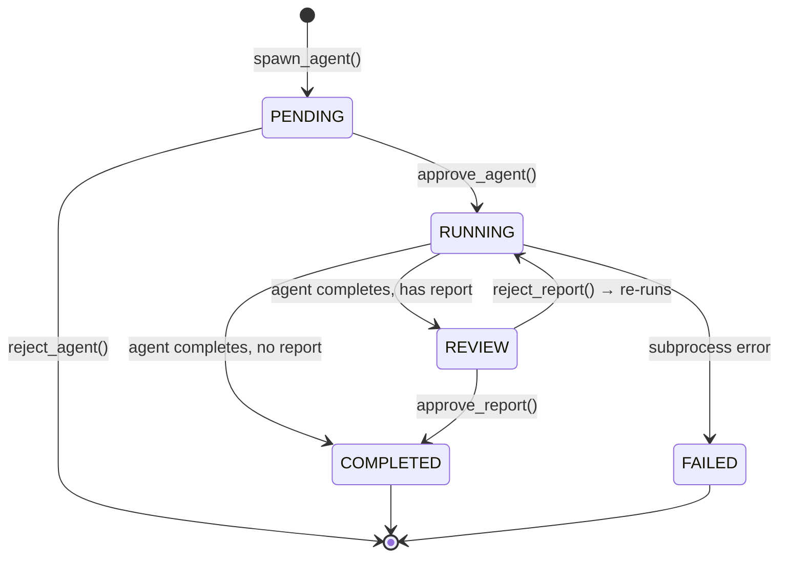
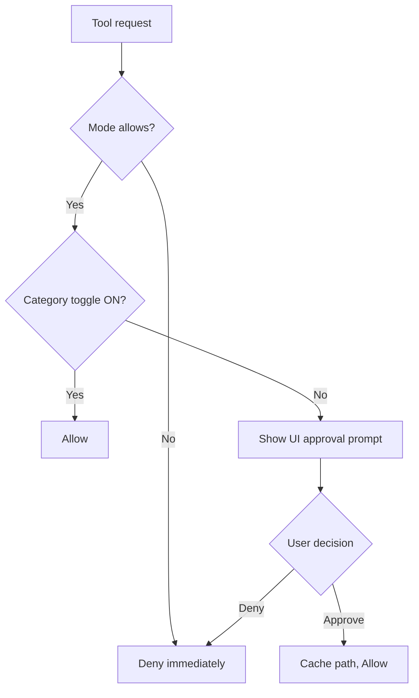
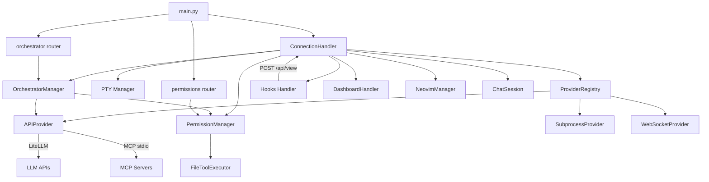

# Component Inventory

Full inventory of every significant component in CADE, with location, responsibility, and dependency relationships.

## Backend Components

### ConnectionHandler

| Field | Value |
|-------|-------|
| File | `backend/websocket.py` (~1,957 lines) |
| Entry | `ConnectionHandler.handle()` |
| Responsibility | Manages one WebSocket connection lifecycle — authentication, project routing, message dispatch, PTY lifecycle, chat streaming, file ops, Neovim, dashboard, agent events, permission prompts |

**Key methods:**

- `handle()` — Top-level connection loop; authenticates, calls `_setup()`, then runs receive/PTY output loops concurrently
- `_setup()` — Spawns PTY, joins the directory's shared `ProjectServices`, initialises provider registry and permission manager
- `_forward_file_changes()` — Sends this connection's queued file-change bursts as `file-changes` messages and feeds them to its `DashboardHandler`
- `_handle_message()` — Routes incoming WebSocket messages to sub-handlers by type
- `_stream_chat_response()` — Opens a provider stream and forwards `ChatEvent` objects to the client
- `_pty_output_loop()` — Reads PTY output bytes and sends them as OUTPUT messages

**Depends on:** `Config`, `ProviderRegistry`, `PermissionManager`, `OrchestratorManager`, `FileToolExecutor`, `NeovimManager`, `DashboardHandler`, `ChatSession`

**Depended on by:** FastAPI route in `main.py`

---

### ProjectServices

| Field | Value |
|-------|-------|
| File | `backend/project_services.py` |
| Entry | `acquire_project(root, listener)` / `release_project(services, listener)` |
| Responsibility | Owns the `WatchProcess`, `DocIndexService` and `NkrdnService` for one resolved directory, shared by every connection open on it |

Each tab is its own WebSocket connection, and several tabs are often open on one project. When each connection ran its own watcher and index services, a burst of file changes was processed once per tab and every code edit started one nkrdn rebuild per tab. Connections now register a `ProjectListener` with the directory's single `ProjectServices`; the first registration starts the watcher and the last release stops it and cancels pending rebuilds.

**How it works:**

- The watch loop reads `WatchProcess.watch_batches()`, so a debounced burst moves through the system as one list. Each burst goes to the index services per event (they debounce their own rebuilds) and to every listener as a whole.
- Listener callbacks are synchronous and only enqueue. Each `ConnectionHandler` drains its own queue in `_forward_file_changes()`, so a slow or dead socket delays only its own tab, and a listener that raises is logged without stopping the others.
- `enable_indexing()` creates the index services and runs their initial builds once, on the first non-kiosk connection. Later tabs reuse the result and receive the current graph on connect. A directory opened only in kiosk mode is watched but not indexed.
- Watcher failures (including a worker that exits on its own) are retried with exponential backoff (2s, 4s, 8s) by recreating the watcher; after that, watching stays off and tabs stop receiving live updates.

**Why the watcher is a separate process:** watchfiles registers a recursive inotify watch inside its Rust constructor while holding the GIL, and registration walks every entry under the root. On a project with a few hundred thousand files that is about seven seconds with a warm cache, during which the whole backend was frozen and every tab's terminal stopped; running the constructor on a thread does not help because of the GIL. `WatchProcess` (`backend/watch_process.py`) launches `backend/watch_worker.py` as a child process, one per open project, which runs the in-process `FileWatcher` and streams each burst back as a JSON line on stdout. The child is driven with a plain `Popen` and blocking reads on worker threads rather than asyncio's subprocess transport, because cancelling a task while that transport is still connecting its pipes leaves the event loop unable to close on CPython 3.12. The worker stops when its stdin closes, so a backend that dies takes its workers with it. The packaged binary exposes it as `cade-backend watch <dir>`, dispatched at the top of `backend/main.py` before the server imports so each worker stays small.

**Boundaries:** `DashboardHandler` stays per connection, because each tab may show a different dashboard file. Opening a second tab no longer re-runs the initial nkrdn build; the directory is already being watched, so the graph is current.

**Probes before indexing:** `has_code()` (`nkrdn_service.py`) and `has_docs()` (`doc_index.py`) decide whether a directory is worth indexing. Both use `walk_project()` in `backend/files/listing.py`, which prunes the directories the file tree ignores (name-ignored and root-gitignored) and stops after a bounded number of directories, answering "yes" past the limit so the indexer decides. They run in a thread. An unpruned `rglob` on the event loop took six seconds on a project whose gitignored trees held a million files, with every tab frozen for the duration.

- Before fan-out, each event is tagged with whether the root `.gitignore` hides its path (`gitignore_matcher`, one `.gitignore` read per burst), and the worker has already recorded whether a created path is a directory. Tabs patch their file trees from these events instead of refetching them, so the message has to carry what a client cannot find out for itself.

**Depends on:** `WatchProcess` (wrapping `FileWatcher` in a child process), `DocIndexService`, `NkrdnService`, file-tree cache (invalidated for each changed path that lies within the levels a cached tree shows)

**Depended on by:** `ConnectionHandler`

---

### FastAPI Application (`main.py`)

| Field | Value |
|-------|-------|
| File | `backend/main.py` (~1,174 lines) |
| Entry | `create_app()` → ASGI app; `main()` → CLI |
| Responsibility | Mounts all HTTP routes, WebSocket endpoint, static files, auth middleware; CLI parsing for `serve`/`view`/`setup-hook` subcommands |

**REST API groups:**

| Prefix | Module | Purpose |
|--------|--------|---------|
| `/api/orchestrator/` | orchestrator router | Agent spawn, approve, reject, status |
| `/api/permissions/` | permissions router | Prompt-and-wait, approve, deny, state, set |
| `/api/view` | inline | Receive hook POST, broadcast VIEW_FILE |
| `/api/neovim/` | neovim router | Diff endpoints |
| `/ws` | websocket handler | Main WebSocket connection |
| `/` | StaticFiles | Serves `frontend/dist/` |

**Depends on:** All backend subsystem modules

---

### OrchestratorManager

| Field | Value |
|-------|-------|
| File | `backend/orchestrator/manager.py` (~400 lines) |
| Responsibility | Spawns AI agent subprocesses, manages two-gate approval flow (spawn approval + report approval), tracks agent state, routes output to owning connection only |

**Agent lifecycle:**

**Key methods:**

- `spawn_agent(spec)` → `AgentRecord` in PENDING state
- `approve_agent(agent_id)` → starts an `APIProvider` worker via `_make_worker_provider()`
- `await_completion(agent_id)` → blocks until COMPLETED/FAILED
- `approve_report()` / `reject_report()` → gate on final summary review

**Depends on:** `PermissionManager`, `APIProvider`

**Depended on by:** `ConnectionHandler`, orchestrator HTTP router

---

### PermissionManager

| Field | Value |
|-------|-------|
| File | `backend/permissions/manager.py` (~400 lines) |
| Responsibility | Single source of truth for current mode, category toggles, and interactive approval requests |

**Permission model:**

**Toggles:** `allow_read`, `allow_write`, `allow_tools`, `allow_subagents`, `auto_approve_reports`

**Modes:** `code`, `architect`, `review`, `orchestrator`

**Tool classification:**

- READ_TOOLS: `Read`, `Glob`, `Grep`, `LS`, `list_directory`, `View`, `Cat`
- WRITE_TOOLS: `Write`, `Edit`, `MultiEdit`, `Create`, `Delete`, `Move`, `Rename`

**Depends on:** `asyncio.Event` (for blocking approval), WebSocket sender reference

**Depended on by:** `ConnectionHandler`, `FileToolExecutor`, `OrchestratorManager`, permissions HTTP router

---

### ProviderRegistry

| Field | Value |
|-------|-------|
| File | `backend/providers/registry.py` |
| Responsibility | Manages provider instances; resolves global vs project-local providers; handles provider switching |

**Resolution order:** project-local (`launch.yml`) → global (`~/.cade/providers.toml`) → default

**Depended on by:** `ConnectionHandler`, orchestrator

---

### SubprocessProvider

| Field | Value |
|-------|-------|
| File | `core/backend/providers/subprocess_provider.py` |
| Responsibility | Runs an arbitrary CLI command with streaming JSON output; supports `initial_command` for bootstrap |

**Depended on by:** `ProviderRegistry` (project-local providers in `launch.yml`)

---

### WebSocketProvider

| Field | Value |
|-------|-------|
| File | `core/backend/providers/websocket_provider.py` |
| Responsibility | Connects to a persistent WebSocket server; handles unsolicited server-pushed events; supports Google OAuth auth; implements `set_event_handler()` and `send_frame()` |

**Depended on by:** `ProviderRegistry` (used by Padarax game engine and similar)

---

### FileToolExecutor

| Field | Value |
|-------|-------|
| File | `backend/tools/file_tools.py` (~150 lines) |
| Responsibility | Executes file read/write MCP tools with permission enforcement and path scope checking |

**Tools exposed:**

| Tool | Description |
|------|-------------|
| `read_file` | Read file content, optional line range |
| `list_directory` | List files in directory |
| `write_file` | Overwrite entire file |
| `edit_file` | Replace unique string in file |
| `delete_file` | Delete file |

**Depends on:** `PermissionManager`

**Depended on by:** MCP tool registry passed to `APIProvider`

---

### Hooks System

| Field | Value |
|-------|-------|
| Files | `backend/hooks/commands.py`, `installer.py`, `settings.py`, `wsl_path.py` |
| Responsibility | Generates and installs a Claude Code `PostToolUse` hook; receives HTTP POST when CC edits a file; broadcasts `VIEW_FILE` to connected clients |

**Hook flow:** CC edits file → hook script → `POST /api/view` → `VIEW_FILE` WebSocket message → frontend viewer overlay

**Depended on by:** `main.py` (`/api/view` route), CLI `setup-hook` subcommand

---

### Prompts & Skills

| Field | Value |
|-------|-------|
| Files | `backend/prompts/__init__.py`, `backend/prompts/slash_commands.py` |
| Responsibility | Assembles mode-specific system prompts from modular markdown files; loads bundled and user-defined skills as slash commands |

**compose_prompt(mode)** — Concatenates: base rules + mode-specific instructions + bundled rules from `.claude/rules/`

**build_slash_commands()** — Returns registered skills: bundled (handoff, plan, architect, code, review, orch, compact) + user skills from `~/.claude/skills/`

**Depends on:** `backend/prompts/bundled/`, `~/.claude/skills/`, `~/.claude/rules/`

**Depended on by:** `ConnectionHandler` (prompt injection), `WebSocketClient` (skill invocation)

---

### DashboardHandler

| Field | Value |
|-------|-------|
| Files | `core/backend/dashboard/handler.py`, `core/backend/dashboard/config.py` |
| Responsibility | Loads `.cade/dashboard.yml`, watches for config changes, polls data sources, broadcasts updates to frontend |

**Data source types:** `directory` (scans markdown frontmatter), `rest` (polls HTTP endpoint), `model_usage` (LiteLLM metrics)

**Config watch:** the handler notices `.cade/dashboard.yml` appearing, changing or vanishing with two *non-recursive* watches, one on the project root (to see `.cade/` itself come or go) and one on `.cade/` when it exists, re-registering when that directory appears or disappears. It used to be one recursive watch over the whole project per connection. watchfiles registers a recursive watch while holding the GIL, so each tab opened on a 188k-directory project froze the backend for 14 to 26 seconds, and the watches it held (one per directory, per tab) exhausted the user's inotify budget, after which nothing on the machine could register a new watch.

**Depended on by:** `ConnectionHandler`

---

### PTY Manager / Terminal

| Field | Value |
|-------|-------|
| File | `backend/terminal/` |
| Responsibility | Spawns and manages PTY sessions; supports session resumption with scrollback; handles resize |

**Platform support:** pexpect (Unix), pywinpty (Windows), plus `InheritedPTY` for a master descriptor and child pid taken over from a previous program image (see In-place Upgrade). `BasePTY.stop_reading()` pauses a reader after the chunk in flight instead of cancelling it, so a handoff loses nothing the worker thread had already read.

**Depended on by:** `ConnectionHandler`, `backend/upgrade.py`

---

### In-place Upgrade

| Field | Value |
|-------|-------|
| File | `backend/upgrade.py` |
| Entry | `POST /api/upgrade`, `cade-backend upgrade`, `UpgradeCoordinator` |
| Responsibility | Switch the running backend to a newly installed build without ending any terminal session |

The backend is the parent of every shell and holds every PTY master, so a restart ends every session. An upgrade instead replaces the process's program image with `os.execv`. The pid is unchanged, so the shells stay its children (`waitpid` keeps working, nothing is reparented) and the desktop sidecar's handle on the child stays valid with no Rust changes. The PTY masters and the HTTP listening socket are descriptors and survive the exec once their close-on-exec flag is cleared. Everything else (session ids, labels, working directories, scrollback with sequence numbers, terminal sizes, attention state, enhanced-chat history) travels in a JSON manifest at `~/.cade/upgrade/handoff.json`, which the new image adopts in its lifespan before any tab reconnects.

**How it works:**

1. `request()` verifies the target binary answers `--version` (a one-file PyInstaller build extracts itself first, so this is allowed 30s) and marks the upgrade pending. The default target is the backend's own path, which after a reinstall holds the new build.
2. The coordinator waits until no chat response is streaming, capped at ten minutes (`DEFAULT_IDLE_CAP_SECONDS`), then proceeds anyway with the partial reply kept. Shells and CLI agents mid-task do not count as busy: their processes are untouched.
3. `perform_handoff()` broadcasts `upgrading` to every tab, pauses each PTY reader, exports the registry and chat sessions, marks the descriptors inheritable, writes the manifest, flushes the logs and execs `exec_argv()`: the same `serve` arguments this process started with plus `--resume-handoff <manifest>`.
4. The new image binds nothing: `run_serve` adopts the listener from the manifest and hands it to uvicorn, and `lifespan` rebuilds each session around `PTYManager.adopt(fd, pid)` with its scrollback and `last_seq`, adopts the chat registry, removes the old image's extraction directory and deletes the manifest.
5. Tabs see their socket drop and reconnect by the ordinary backoff. The `connected` message carries `buildVersion`; a page that sees a different value from the one it first connected with reloads once, then its tabs re-attach to their live sessions as on any reconnect.

Measured on a dev backend: same pid, about 1.6s between the exec and the first reconnect, pre-upgrade scrollback replayed.

**Design decisions:**

- *Exec in place rather than fd passing to a second process.* Passing descriptors over `SCM_RIGHTS` works, but the shells would be reparented to init when the old process exited, `waitpid` would stop working, and the Tauri sidecar handle would point at a dead pid. Keeping the pid removes all three problems and needs no protocol.
- *The listening socket is bound by the backend, not uvicorn.* `run_serve` binds it (`bind_listener`) and passes it to `uvicorn.Server.run(sockets=[...])`, so it is a known descriptor the manifest can name. uvicorn's own `fd` option was avoided because it wraps the fd as `AF_UNIX` regardless of family.
- *Readers are paused, not cancelled.* Cancelling the reader task would drop the chunk the worker thread was mid-`read`. `stop_reading()` lets that read finish and publish; output the shell writes afterwards waits in the kernel's PTY buffer for the new image's reader.
- *The old `_MEIPASS` is removed by the new image.* The PyInstaller bootloader cleans its extraction directory only on a normal exit, which exec is not. Deleting it before the exec would leave the old process unable to import anything if the exec then failed, so the new image deletes it, and only when it is a sibling of its own extraction directory (`remove_old_extraction`). A failed handoff rolls back to a fully working backend: readers restart and descriptors go back to close-on-exec.
- *A failed `--version` refuses the upgrade* rather than exec'ing into a binary that may not start. Nothing is exported until the target checks out.

**Configuration:** `POST /api/upgrade` with optional `{"executable": path, "now": true}`; `GET` reports state (`idle`, `pending` with `busyReason`, `upgrading`, `unsupported`) and the running `buildVersion`; `DELETE` cancels a pending upgrade. `cade-backend upgrade [--exe PATH] [--now] [--status]` wraps the API using `~/.cade/port` and `~/.cade/host`. `make install-desktop` calls it after dpkg, so the window between "new binary on disk" and "old image still lazily importing from that path" is seconds; a one-file PyInstaller binary opens its own path on each lazy import, and swapping it under a long-running old image crashes that image with a zlib "incorrect header check".

**Boundaries:** not carried: orchestrator worker agents (in-process tasks, re-spawnable from their task string), in-flight chat streams (the partial reply is kept), file-tree caches and index builds (they restart). Windows has no `exec` and ConPTY handles do not travel this way, so `supported()` is false there and an upgrade still means a restart. The Tauri shell itself cannot be upgraded this way. A backend older than this feature has no endpoint, so the first upgrade onto a build that has it is still a restart.

**Depended on by:** `main.py` (routes, `--resume-handoff`, listener), `ConnectionHandler` (`buildVersion`), `Makefile` (`install-desktop`)

---

### NeovimManager

| Field | Value |
|-------|-------|
| File | `backend/neovim/` |
| Responsibility | Spawns Neovim as a PTY subprocess; forwards I/O; generates diff hunks for file edits |

**Depended on by:** `ConnectionHandler`

---

## Frontend Components

### App Bootstrap (`main.ts`)

| Field | Value |
|-------|-------|
| File | `frontend/src/main.ts` (~38,800 lines) |
| Responsibility | Initializes WebSocket client, mounts root UI, wires global keyboard shortcuts, manages layout (tab bar, pane splits) |

---

### WebSocketClient

| Field | Value |
|-------|-------|
| File | `frontend/src/platform/websocket.ts` |
| Responsibility | Typed WebSocket wrapper; appends auth tokens to URL; routes server events to registered listeners; handles reconnection |

**Depends on:** `core/frontend/platform/` base classes

---

### Chat Pane

| Field | Value |
|-------|-------|
| File | `frontend/src/chat/chat-pane.ts` (~40,200 lines) |
| Responsibility | Renders chat history; streams incoming events (text-delta, tool-use-start, tool-result); handles slash commands, mode switches, provider selection; shows permission prompt modals |

---

### Terminal Manager

| Field | Value |
|-------|-------|
| Files | `frontend/src/terminal/terminal.ts` (~15,100), `terminal-manager.ts` (~22,400) |
| Responsibility | xterm.js wrapper (canvas/WebGL renderer, fit addon); multi-terminal orchestration for Claude + manual sessions; session restoration with scrollback |

---

### File Tree

| Field | Value |
|-------|-------|
| File | `frontend/src/file-tree/` |
| Responsibility | Lazy-load directory children; gitignore-aware filtering; file type icons; click-to-open |

---

### Markdown Viewer

| Field | Value |
|-------|-------|
| File | `frontend/src/markdown/` |
| Responsibility | Milkdown editor for GFM rendering with math (LaTeX), diagrams (Mermaid), and syntax highlighting; editor mode for interactive editing |

---

### Neovim Pane

| Field | Value |
|-------|-------|
| File | `frontend/src/neovim/neovim-pane.ts` |
| Responsibility | Renders Neovim PTY output; forwards key input; shows diff split view |

---

### Dashboard Renderer

| Field | Value |
|-------|-------|
| File | `frontend/src/dashboard/` |
| Responsibility | Renders dashboard panels from config (cards, table, checklist, kanban, key_value, markdown, entity_detail); hot-reloads on config changes |

Components extend `BaseDashboardComponent` and receive `{ panel, data, allData, config, onAction }`. The `entity_detail` component is composition-driven — its layout is declared in YAML via `options.sections`, with each section delegating to either inline renderers (header, key_value, prose, cross_refs) or another registered component (claims). New content types are added by writing YAML, not TypeScript.

### EntityResolver

| Field | Value |
|-------|-------|
| File | `frontend/src/platform/entity-resolver.ts` |
| Responsibility | Pluggable interface for resolving `@type:id` cross-reference tokens to file paths. Projects register an implementation at startup via `setEntityResolver()`; dashboard components call `getEntityResolver()` as a fallback when in-memory `allData` lookups miss |

**When to register one:** if your project's content uses `@type:id` cross-reference syntax inside prose fields and you want clicks to navigate. Without a resolver registered, `entity_detail` and `claims` components fall back to `allData` lookup only — fine if every referenced entity is already loaded as a dashboard data source, but it won't navigate to entities outside the dashboard's loaded scope.

**Pre-computed liveness via `_ref_status`:** if you also generate enriched copies of your content with a per-ref `_ref_status` map (`{"@type:id": "resolved" | "stub" | "dead"}`), components prefer that over runtime resolution — a ref marked `"dead"` renders unclickable even if the resolver would build a path for it. This lets a build-time validator (which has full corpus knowledge) drive the viewer's UX without runtime indexing.

---

### Type Definitions

| Field | Value |
|-------|-------|
| File | `frontend/src/types.ts` (~14,900 lines) |
| Responsibility | TypeScript interfaces for all WebSocket message payloads; shared by all frontend components |

---

## Core Shared Module

| Component | File | Purpose |
|-----------|------|---------|
| `BaseProvider` | `core/backend/providers/base.py` | Abstract interface: `stream_chat()`, `capabilities`, lifecycle |
| `ChatEvent` types | `core/backend/providers/types.py` | `TextDelta`, `ThinkingDelta`, `ToolUseStart`, `ToolResult`, `ChatDone`, `ChatError` |
| `ChatMessage` | `core/backend/providers/types.py` | `{role, content}` conversation turn |
| `ToolDefinition` | `core/backend/providers/types.py` | `{name, description, parameters_schema}` |
| `ProviderConfig` | `core/backend/providers/config.py` | Config loading from TOML with env-var interpolation |
| `ChatSession` | `core/backend/chat/session.py` | In-memory history registry keyed by session ID |
| `DashboardConfig` | `core/backend/dashboard/config.py` | YAML schema for dashboard configuration |
| `FileWatcher` | `core/backend/watcher.py` | Debounced file change notifications via watchfiles; `watch_batches()` yields each burst as a list, `watch()` yields single events |
| `WatchProcess` | `backend/watch_process.py` | Same surface as `FileWatcher`, but runs it in a `backend/watch_worker.py` child process so registering watches on a huge tree cannot stall the backend |

---

## Dependency Graph

## See Also

- [[overview|Architecture Overview]]
- [[data-flow|Data Flow]]
- [[dependencies|Dependencies]]
- [[../technical/reference/websocket-protocol|WebSocket Protocol Reference]]
