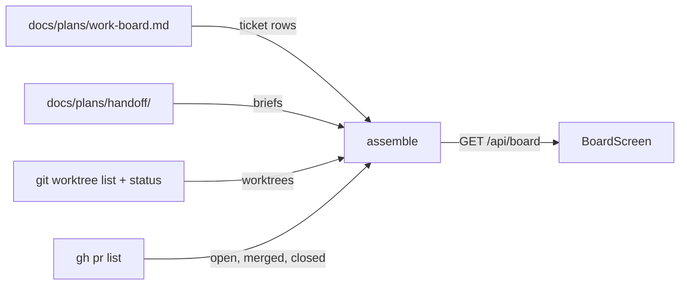

# The Board

One screen for a project's streams of work: each ticket with the handoff, worktree, branch and pull request that carry it, and the things no ticket claims. It builds on the pull request and working tree readers in [[pull-requests]] and the handoff listing in [[project-picker]].

> [!NOTE]
> Built, tested, and run against a real project's data from the backend. The screen itself had been seen only in a headless render with invented data when this was written, not in the installed app.

## Purpose

A project with many streams keeps a table by hand: which ticket, which handoff, which worktree and branch, which pull request, what is next. Every mechanical column of that table is stale the moment it is written, and keeping it current is a chore handed to every agent in every commit.

The board keeps what only a person knows and fetches the rest. The table says which ticket goes with which handoff and worktree, and what is next. CADE reads the worktree's state from git, the pull request's from GitHub and the handoff's age from disk, each time the board is opened.

It only reads. The board file is never edited, and a worktree is described, never removed.

## How it works

### Reading the board file

`parse_board` (`backend/board.py`) reads `docs/plans/work-board.md`. Any markdown table with a column headed "Ticket" counts, and the other columns are found by name (title, linear, handoff, worktree, next), so tables of different shapes in one file all read. From a row it takes the ticket id and link, the title, the status with whatever follows it in brackets, the doc a session on it starts from, every backticked name and `#number` in the worktree column, and the next step.

The file is edited by people and agents and its shape drifts. Within a day of this being built, the column naming each row's handoff was renamed from "Handoff" to "Resumption owner" and began to hold links to plans as well as handoffs, and every row lost its handoff here until the reader was loosened. The owning doc is now found in a column called handoff, resumption or owner, and failing that in any link into the handoff folder anywhere in the row. A link elsewhere in the plans folder is read as a plan (`_owner_doc`) and stands in the handoff's place: it is what a session on that ticket is opened on. A link that leads outside the project is not followed. The heading a table sits under is kept as the row's section.

A project with no board file still has a board: its handoffs and worktrees, all unassigned.

### Tickets from the tracker

With a key, each ticket's title, status, link and parent are read from Linear (`backend/linear.py`) and the board file's copies of them are ignored (`overlay_tracker`). The file keeps what only it knows: the handoff, the worktree and the next step. Three things are read, in a second or so:

- the key owner's unfinished tickets, a page at a time;
- the tickets the board file names, whoever they belong to and whatever their state, one request per team;
- the parents above any of those, up to `PARENT_LEVELS` levels, so the parent view has its upper levels and can name a parent that is not a row.

An unfinished ticket of the owner's that the file does not mention becomes a row of its own, with no handoff: it is theirs to do whether or not anyone wrote it down. A ticket is finished or queued by the tracker's own kind of state (`statusType`: backlog, unstarted, started, completed, canceled, triage), which holds whatever a team has named its states.

The key is `LINEAR_API_KEY`, from the environment or `~/.cade/.env`. A key made with only the Read permission is all it needs: this module sends queries and nothing else. Without a key, or when Linear cannot be reached, the board shows what the file says and its top line says so ("tickets from the board file"). The first board the screen draws is never live, since it must not wait on the network.

### Worktrees and their verdicts

The repositories of a project are the project itself and each folder under `repos/`, counted once per repository however many worktrees sit beside it. For each, `git worktree list` gives the worktrees and `git status --porcelain=v2 --branch` (at most `STATUS_CONCURRENCY` at once) gives each one's branch and pending work. GitHub is asked once per repository, through `gh api graphql`, for the newest pull requests of each branch that is checked out (`branch_query`); an open one stands for the branch before a merged one before a closed one. Repositories are read at the same time, and within one, GitHub and the working trees are too.

Each worktree gets a verdict, worked out one way (`verdict`):

| Verdict | Means |
|---|---|
| finished | Pull request merged, nothing in the worktree newer than what merged, working tree clean |
| merged, holds work | Merged, but removing the worktree would lose uncommitted changes or later commits |
| in review | Pull request open |
| closed | Pull request closed without merging |
| no pull request | None found for the branch |

"Finished" is strict on purpose. "Nothing newer" means the worktree's commit is the pull request's head or an ancestor of it; the second case covers a branch updated on GitHub after the last local pull, which is behind the merged head and loses nothing. A merge cannot be read from git alone: a squash merge leaves the branch outside the base branch, so the pull request's own state is the signal.

### Joining

`assemble` attaches to each ticket row the handoff it names and every worktree it names by folder, by branch or by pull request number. A handoff named on the board but missing from disk is reported as such. Handoffs and worktrees that no row names are returned as their own lists: they are the gaps the board exists to show.

Gathering runs git in every worktree and asks GitHub, which takes a few seconds on a large project (under four for one with 81 worktrees across eleven repositories). A gathered board is cached for `CACHE_SECONDS`, and two requests for one project share one gathering.

So that the screen never opens empty, it asks twice. `GET /api/board?quick=true` answers at once with the last full board if there is one, however old, and otherwise with the tickets and handoffs alone, marked `partial`; the screen draws that, then asks for the full board and swaps it in, keeping the selection on the row it was on. A partial board says "reading" where its worktrees would be, since not yet read is not the same as none.

### The screen

`BoardScreen` (`frontend/src/board/board-screen.ts`) is a full-pane screen in the picker's language; `board-model.ts` decides what is listed and is tested without a DOM. `Alt+b` opens it for the project of the tab in front.

**Streams, not tickets.** The row is a stream: one handoff and every ticket it carries (`groupStreams`), or a ticket with no handoff on its own. A handoff is what a session is opened on, and one often carries several tickets; on one real project 42 tickets in play are carried by 19 handoffs, and listed one ticket per row the same line appeared up to four times.

**Grouped by what each needs.** `stageOf` puts a stream at one stage, the most pressing that applies:

| Stage | When | Opens |
|---|---|---|
| Needs you | An open pull request conflicts, fails, has changes asked for, or is approved with nothing left to wait for | unfolded |
| In review | A pull request is open and waiting on checks or a reviewer | unfolded |
| Close out | No open pull request, one has merged, and a ticket is still open in the tracker | unfolded |
| In progress | Work is under way and there is no pull request yet | unfolded |
| Queued | Nothing in it has started | folded |
| Done | Every ticket is finished | folded |

After these come the board file's other headings (deferred, coming, and so on), handoffs with no ticket, and worktrees not on the board, all folded. A folded section is one row with its name and count; Enter unfolds it and `h` folds the section the selection is in. The screen therefore opens on what is to be acted on: seventeen rows for that project, where the first version opened on about a hundred and fifty.

**By parent.** `v` switches to a second arrangement: each ticket that others sit under heads a section, with those beneath it and theirs beneath them, indented. A parent that is not itself a row still heads its section, named when the tracker gave its title. The parent comes from the tracker when it is read, and otherwise from the board file ("parent ABC-1" or "child of ABC-1" in a row's tracker column); tickets with none are gathered in one folded section.

**Search.** The search line is always on show. It matches ticket ids, titles, statuses, parents, handoff names and titles, worktrees, branches and `#numbers`, needs every word, looks inside folded sections and shows what it finds there unfolded. The first Escape gives the whole board back; the second closes it.

The line at the top counts the streams at each stage and the worktrees that are finished. The right column is everything known about the selected row: for a stream, each of its tickets with status and parent, the handoff and its age, each worktree with its branch, pending work and verdict, each pull request, and the next step recorded for each open ticket.

| Key | Does |
|---|---|
| `j` / `k`, `g` / `G` | Move |
| `]` / `[` | Next / previous section |
| `Enter` | Open a tab on the stream's handoff or a worktree's folder; unfold a folded section |
| `h` | Fold the section the selection is in |
| `v` | By need / by parent |
| `/` | Search |
| `t` / `p` | Open the ticket / the pull request in the browser |
| `r` | Read again, past the cache |
| `Esc` | Clear the search, then close |

A tab opened from the board joins the open workspace, runs the agent of the tab in front, and is handed the handoff's path, as from the picker.

## Design decisions

- **The hand-kept table is the source of the mapping, not something to replace yet.** Nothing else records which ticket goes with which handoff and worktree: few handoffs name a ticket and few branches carry an id. Reading the table gives a useful board today, without CADE needing access to the tracker, and leaves the table's upkeep to shrink to the columns only a person can fill.
- **The tracker's word over the file's, where the tracker knows better.** The file recorded a parent for 9 of 62 tickets on one real project; the tracker gave one for 54, and showed several tickets finished that the file still called in progress. Title, status and parent therefore come from the tracker when it can be read, and the mapping to handoffs and worktrees, which the tracker does not have, stays the file's.
- **The picker's look, not a table.** A first mock drew the board as an eight-column table and was rejected as cluttered. The built screen reuses the picker's rows, with the detail beside the list instead of in more columns.
- **By need, not by tracker status, and folded.** The first built version listed every ticket under its tracker status, then every unassigned handoff and worktree. It was one long list that answered nothing: "in progress" covered a failing pull request, one merged days before and one not yet opened, and sixty worktrees nobody needed sat at the bottom. Grouping by what a stream needs answers "what should I be doing", and folding the rest keeps that answer on one screen.
- **Quiet section headings.** The picker's filled red bars, repeated for eight sections, were the loudest thing on the screen. The board's headings are text with a rule, and red is kept for the selected row and the detail's title.
- **Ask GitHub about our branches, not for its pull requests.** The first version listed each repository's open, merged and closed pull requests and looked for ours among them. That took twenty seconds on a real project, nearly all of it GitHub: hundreds of pull requests per repository, one repository a fork carrying its upstream's, each repository in turn. It also missed anything older than the list's limit. Asking by branch costs the same however many pull requests a repository has, and finds one that merged long ago.
- **Verdicts live in the backend** so that the board, a count elsewhere and a future cleanup skill all agree on what "finished" means.

## Configuration

| Knob | Where | Default |
|---|---|---|
| Board file | `BOARD_FILE` in `board.py` | `docs/plans/work-board.md` |
| Folder of clones and worktrees | `REPOS_DIR` | `repos` |
| Worktree status checks at once | `STATUS_CONCURRENCY` | 8 |
| Cache | `CACHE_SECONDS` | 60 s |
| Branches asked about per GitHub request | `BRANCHES_PER_QUERY` | 50 |
| Tracker key | `LINEAR_API_KEY`, environment or `~/.cade/.env` | none |
| Levels of parents followed | `PARENT_LEVELS` in `linear.py` | 3 |

## Boundaries

- Linear only, and read only. Nothing is written to the tracker, and other trackers are not supported.
- Without a key the titles, statuses and parents are what the board file says, and it records a parent for few tickets.
- No cleanup. The board says which worktrees are finished; removing them is planned as a skill ([[../../plans/worktree-cleanup]]).
- A running session is not shown against its stream. Tabs are often opened on the project root, so a tab's folder does not say which stream it serves.
- One project at a time: the board is for the project of the tab in front, not for a whole workspace.
- Not on the phone.

## See Also

- [[pull-requests]] - pull request state and the strip above the terminal
- [[project-picker]] - handoffs and opening tabs
- [[tab-groups]] - workspaces
