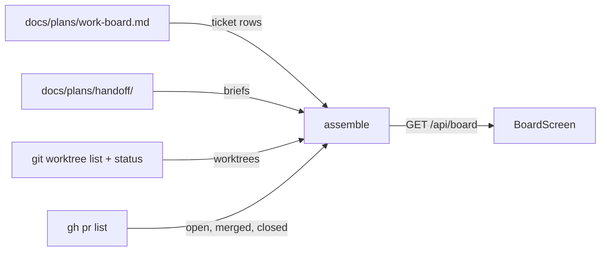

# The Board

One screen for a project's streams of work: each ticket with the handoff, worktree, branch and pull request that carry it, and the things no ticket claims. It builds on the pull request and working tree readers in [[pull-requests]] and the handoff listing in [[project-picker]].

> [!NOTE]
> Built, tested, and run against a real project's data from the backend. The screen itself had been seen only in a headless render with invented data when this was written, not in the installed app.

## Purpose

A project with many streams keeps a table by hand: which ticket, which handoff, which worktree and branch, which pull request, what is next. Every mechanical column of that table is stale the moment it is written, and keeping it current is a chore handed to every agent in every commit.

The board keeps what only a person knows and fetches the rest. The table says which ticket goes with which handoff and worktree, and what is next. CADE reads the worktree's state from git, the pull request's from GitHub and the handoff's age from disk, each time the board is opened.

It only reads. The board file is never edited, and a worktree is described, never removed.

## How it works

### Reading the board file

`parse_board` (`backend/board.py`) reads `docs/plans/work-board.md`. Any markdown table with a column headed "Ticket" counts, and the other columns are found by name (title, linear, handoff, worktree, next), so tables of different shapes in one file all read. From a row it takes the ticket id and link, the title, the status with whatever follows it in brackets, the handoff a wiki-link names, every backticked name and `#number` in the worktree column, and the next step. The heading a table sits under is kept as the row's section.

A project with no board file still has a board: its handoffs and worktrees, all unassigned.

### Worktrees and their verdicts

The repositories of a project are the project itself and each folder under `repos/`, counted once per repository however many worktrees sit beside it. For each, `git worktree list` gives the worktrees and `git status --porcelain=v2 --branch` (at most `STATUS_CONCURRENCY` at once) gives each one's branch and pending work. GitHub is asked once per repository, through `gh api graphql`, for the newest pull requests of each branch that is checked out (`branch_query`); an open one stands for the branch before a merged one before a closed one. Repositories are read at the same time, and within one, GitHub and the working trees are too.

Each worktree gets a verdict, worked out one way (`verdict`):

| Verdict | Means |
|---|---|
| finished | Pull request merged, nothing in the worktree newer than what merged, working tree clean |
| merged, holds work | Merged, but removing the worktree would lose uncommitted changes or later commits |
| in review | Pull request open |
| closed | Pull request closed without merging |
| no pull request | None found for the branch |

"Finished" is strict on purpose. "Nothing newer" means the worktree's commit is the pull request's head or an ancestor of it; the second case covers a branch updated on GitHub after the last local pull, which is behind the merged head and loses nothing. A merge cannot be read from git alone: a squash merge leaves the branch outside the base branch, so the pull request's own state is the signal.

### Joining

`assemble` attaches to each ticket row the handoff it names and every worktree it names by folder, by branch or by pull request number. A handoff named on the board but missing from disk is reported as such. Handoffs and worktrees that no row names are returned as their own lists: they are the gaps the board exists to show.

Gathering runs git in every worktree and asks GitHub, which takes a few seconds on a large project (under four for one with 81 worktrees across eleven repositories). A gathered board is cached for `CACHE_SECONDS`, and two requests for one project share one gathering.

So that the screen never opens empty, it asks twice. `GET /api/board?quick=true` answers at once with the last full board if there is one, however old, and otherwise with the tickets and handoffs alone, marked `partial`; the screen draws that, then asks for the full board and swaps it in, keeping the selection on the row it was on. A partial board says "reading" where its worktrees would be, since not yet read is not the same as none.

### The screen

`BoardScreen` (`frontend/src/board/board-screen.ts`) is a full-pane screen in the picker's language and uses the picker's styles; `board-model.ts` decides what is listed and is tested without a DOM. `Alt+b` opens it for the project of the tab in front.

The left column lists, in order:

1. Tickets under an "active" heading of the board file, regrouped by status: In Review, In Progress, Todo, Backlog, anything else, Done.
2. The board file's other headings (deferred, coming, and so on), kept as the author grouped them.
3. Handoffs with no ticket.
4. Worktrees not on the board, removable ones first.

The right column is everything known about the selected row: status and its detail, handoff and age, each worktree with its branch, pending work and verdict, each pull request, and the next step.

| Key | Does |
|---|---|
| `j` / `k`, `g` / `G` | Move |
| `Enter` | Open a tab: on the project with the ticket's handoff, or on a worktree's own folder |
| `t` | Open the ticket in the browser |
| `p` | Open the pull request in the browser |
| `/` | Filter by ticket, title, status, handoff, worktree, branch or `#number` |
| `r` | Read again, past the cache |
| `Esc` | Close |

A tab opened from the board joins the open workspace, runs the agent of the tab in front, and is handed the handoff's path, as from the picker.

## Design decisions

- **The hand-kept table is the source of the mapping, not something to replace yet.** Nothing else records which ticket goes with which handoff and worktree: few handoffs name a ticket and few branches carry an id. Reading the table gives a useful board today, without CADE needing access to the tracker, and leaves the table's upkeep to shrink to the columns only a person can fill.
- **Ticket status is the table's, with its date.** It is shown as recorded, including the "read back on" note the table carries, because CADE cannot yet ask the tracker. Reading tickets live is planned.
- **The picker's look, not a table.** A first mock drew the board as an eight-column table and was rejected as cluttered. The built screen reuses the picker's rows and section bars, with the detail beside the list instead of in more columns.
- **Ask GitHub about our branches, not for its pull requests.** The first version listed each repository's open, merged and closed pull requests and looked for ours among them. That took twenty seconds on a real project, nearly all of it GitHub: hundreds of pull requests per repository, one repository a fork carrying its upstream's, each repository in turn. It also missed anything older than the list's limit. Asking by branch costs the same however many pull requests a repository has, and finds one that merged long ago.
- **Verdicts live in the backend** so that the board, a count elsewhere and a future cleanup skill all agree on what "finished" means.

## Configuration

| Knob | Where | Default |
|---|---|---|
| Board file | `BOARD_FILE` in `board.py` | `docs/plans/work-board.md` |
| Folder of clones and worktrees | `REPOS_DIR` | `repos` |
| Worktree status checks at once | `STATUS_CONCURRENCY` | 8 |
| Cache | `CACHE_SECONDS` | 60 s |
| Branches asked about per GitHub request | `BRANCHES_PER_QUERY` | 50 |

## Boundaries

- No live tracker data. Titles and statuses are what the board file says.
- No cleanup. The board says which worktrees are finished; removing them is planned as a skill ([[../../plans/worktree-cleanup]]).
- A running session is not shown against its stream. Tabs are often opened on the project root, so a tab's folder does not say which stream it serves.
- One project at a time: the board is for the project of the tab in front, not for a whole workspace.
- Not on the phone.

## See Also

- [[pull-requests]] - pull request state and the strip above the terminal
- [[project-picker]] - handoffs and opening tabs
- [[tab-groups]] - workspaces
