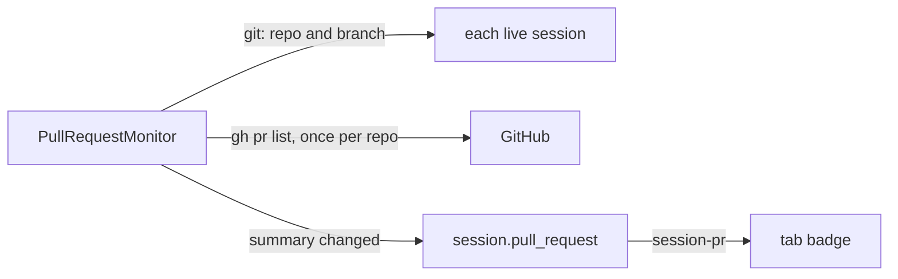

# Pull Request and Work State on Tabs

How a tab shows where its work stands: the pull request for its branch as a badge on the tab, and a strip above its terminal with the pull request, the branch and what is pending on it, and the latest handoff. What is still planned is in [[../../plans/pr-monitoring]].

> [!NOTE]
> Built and tested, and checked against real `gh` output from a public repository. It had not yet run inside the installed app when this was written.

## Purpose

An agent in a tab opens a pull request and then the work leaves the window: checks run, reviews arrive and the branch falls behind on GitHub, where the tab cannot see it. The badge puts the one thing most worth knowing about that pull request on the tab.

It only reads. Nothing here changes a pull request; acting on one stays with the agent in the tab or with `gh`.

## How it works

`PullRequestMonitor` (`backend/pull_requests.py`) starts with the backend and loops:

1. For each live session, ask git which repository its project is in and which branch is checked out (`repo_and_branch`). A project outside a repository, or on a detached HEAD, has no pull request.
2. For each repository found, run `gh pr list` once (`open_pull_requests`), however many sessions share it, and key the open pull requests by head branch.
3. Give each session the summary for its branch, or `None`. A session whose summary changed tells its attached clients with a `session-pr` frame.

The summary (`summarise`) is `{ number, title, url, draft, checks, review, conflicts }`. `checks` reduces every check run and commit status to `failing`, `running` or `passing`; one failure outranks anything still running, since it will not pass as it stands. `review` is `approved`, `changes` or `required`. `conflicts` is true only when GitHub says the pull request conflicts with its base, not while it is still working that out.

The summary lives on the session (`PTYSession.pull_request`), like attention state, so every device attached to a session shows the same thing. It is sent once on attach and included in the session listing as `pullRequest`.

### On the tab

`frontend/src/tabs/pull-request.ts` reduces the summary to one state, worst first:

| State | Mark | When |
|---|---|---|
| conflicts | `≠` | Conflicts with its base |
| failing | `✗` | A check failed |
| changes | `✎` | Changes requested |
| running | `…` | Checks still running |
| approved | `✓` | Approved, nothing wrong |
| passing | none | Checks passed, not yet approved |
| open | none | Nothing else known |

The badge is the number and the mark, coloured by state (`PR_DISPLAY`, `.tab-pr` in `tabs.css`), and dimmed for a draft. Each state that needs attention has its own mark so the meaning does not rest on colour. The tooltip lists everything known, not only the state shown. Clicking opens the pull request in the browser through the shell (`openExternal`), without selecting the tab. `TabBar.setPullRequest` updates the tab in place, as a status change does.

## The strip above the terminal

Each tab has one line between the tab bar and its terminal (`ContextStrip`, `frontend/src/tabs/context-strip.ts`), mounted inside the terminal pane so it is as wide as the terminal and belongs to that tab. It has up to four cells, in this order:

| Cell | Says | Click |
|---|---|---|
| Ticket | The ticket the tab is on, its status and title, and how many more its handoff carries | Opens it in the tracker |
| Pull request | Number, mark and state, then whatever the state leaves unsaid; "merged" or "closed" once it is | Opens it on GitHub |
| Branch | The branch, the number of uncommitted files, commits not yet pushed, or "clean" | |
| Handoff | The handoff the tab is working from, and how long since it was written | Opens it in the viewer |

A cell appears only when there is something to put in it, and the strip is hidden when there are none. `stripCells` decides the cells and is tested without a DOM. When the line is too long for the pane the ticket's title gives way first, then the later cells, and the pull request keeps its room. The terminal refits itself when the strip appears or goes. The phone does not show it.

### The strip is about the tab's stream, not its folder

The first version read everything from the folder the tab was opened on: that folder's branch, its pull request, and the project's newest handoff. Several tabs are often opened on one project folder, each driving a different stream in a worktree beneath it, and every one of those tabs then showed the same line.

So the backend first works out which handoff a session is on (`session_handoff` in `backend/session_context.py`), from the first of these that gives one:

| Source | How |
|---|---|
| Chosen | The handoff picked in the project picker or on the board when the tab was opened. The tab keeps it (`TabInfo.handoff`) and sends it with every `set-project`; the session takes it once, so it survives the backend forgetting the session. |
| Written | The handoff the session's agent last wrote, which the edit hook records per session under `~/.cache/cade-resume/` (`record_handoff_owner` in `backend/hooks/commands.py`). |
| Titled | The handoff the tab's title names. An agent titles its tab after what it is doing ("Review model metrics handoff"), and `handoff_named_in` looks for a handoff's name in those words: the whole name, or its first three or more words, together and in order, the longest match winning and a tie counting as no match. |

With the handoff known, the rest comes from the board's rows for it (`stream_for`, see [[board]]): the tickets it carries, the worktree and pull request that stand for it (one with an open pull request, then a merged one), read from a board no older than `BOARD_MAX_AGE_SECONDS`. The strip's branch and pull request cells then show the stream's worktree in place of the tab's folder, and the tab's badge shows the stream's open pull request.

A tab whose handoff cannot be worked out falls back on its folder's branch and shows no handoff at all: the project's newest handoff, shown on every such tab, said something untrue about most of them. The title rule is a guess, and the handoff cell's tooltip says which source was used.

The folder's own branch and pending work come from `working_tree` (`git status --porcelain=v2 --branch`). `SessionContextMonitor` refreshes every `POLL_SECONDS` (30 s) and only for sessions with a client attached, and a session is also read the moment a client attaches (`refresh_soon`). The result lives on `PTYSession.context` and travels as `session-context`.

The monitor owns every read it starts. A read begun on attach and left to run with nothing to end it hung the test suite at shutdown, which is why `refresh_soon` does nothing while the monitor is stopped and `stop` cancels what is outstanding.

## Design decisions

- **`gh`, not the GitHub API.** The user is already signed in to `gh`, so CADE stores no GitHub credentials of its own.
- **One call per repository.** Several tabs on one repository, or on worktrees of it, cost one request between them. A worktree is its own repository root to git, so each worktree is asked separately; that is correct, since each has its own branch.
- **Matched by branch on every poll.** A tab's branch can change under it, so nothing is remembered about which pull request a session "has".
- **A failed lookup changes nothing.** When `gh` cannot answer for a repository (signed out, no network, no GitHub remote), sessions there keep what they showed. A dropped connection is not a closed pull request.
- **Silent without `gh`.** If `gh` is not installed the monitor does not start and says so once in the log. There is no toast or prompt to sign in: a tab that never has a pull request should not hear about GitHub.
- **The newest pull request for a branch wins** when a branch has more than one open.

## Configuration

| Knob | Where | Default |
|---|---|---|
| Poll interval | `POLL_SECONDS` in `pull_requests.py` | 90 s |
| Interval while checks are running | `POLL_SECONDS_WHILE_RUNNING` | 20 s |
| Timeout for a `git` or `gh` call | `COMMAND_TIMEOUT_SECONDS` | 20 s |
| Open pull requests read per repository | `PR_LIMIT` | 100 |
| Working tree and handoff refresh | `POLL_SECONDS` in `session_context.py` | 30 s |

These are constants, not settings.

## Boundaries

- One GitHub account: whichever `gh` has active. Repositories that account cannot read show nothing.
- No notifications, no list of pull requests, no roll-up on a closed workspace chip, and no rate-limit check. Those are in the plan.
- A remote backend uses its own machine's `gh`, or shows nothing.
- The phone shows neither the badge nor the strip.

## See Also

- [[remote-sessions]] - sessions and how per-session state reaches clients
- [[tab-groups]] - workspaces and tab status marks
- [[../reference/websocket-protocol]] - `session-pr`, `session-context`
- [[project-picker]] - where handoffs are listed
