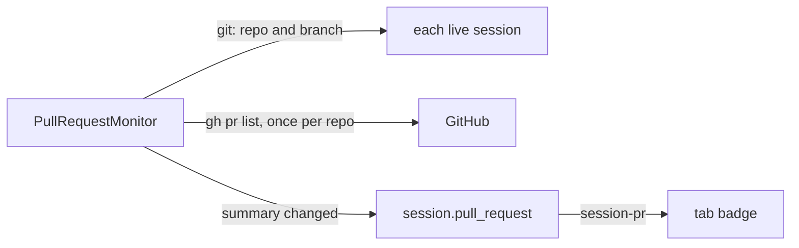

# Pull Request State on Tabs

How a tab shows the pull request for the branch its session is working on. This is the first step of pull request monitoring; what is still planned is in [[../../plans/pr-monitoring]].

> [!NOTE]
> Built and tested, and checked against real `gh` output from a public repository. It had not yet run inside the installed app when this was written.

## Purpose

An agent in a tab opens a pull request and then the work leaves the window: checks run, reviews arrive and the branch falls behind on GitHub, where the tab cannot see it. The badge puts the one thing most worth knowing about that pull request on the tab.

It only reads. Nothing here changes a pull request; acting on one stays with the agent in the tab or with `gh`.

## How it works

`PullRequestMonitor` (`backend/pull_requests.py`) starts with the backend and loops:

1. For each live session, ask git which repository its project is in and which branch is checked out (`repo_and_branch`). A project outside a repository, or on a detached HEAD, has no pull request.
2. For each repository found, run `gh pr list` once (`open_pull_requests`), however many sessions share it, and key the open pull requests by head branch.
3. Give each session the summary for its branch, or `None`. A session whose summary changed tells its attached clients with a `session-pr` frame.

The summary (`summarise`) is `{ number, title, url, draft, checks, review, conflicts }`. `checks` reduces every check run and commit status to `failing`, `running` or `passing`; one failure outranks anything still running, since it will not pass as it stands. `review` is `approved`, `changes` or `required`. `conflicts` is true only when GitHub says the pull request conflicts with its base, not while it is still working that out.

The summary lives on the session (`PTYSession.pull_request`), like attention state, so every device attached to a session shows the same thing. It is sent once on attach and included in the session listing as `pullRequest`.

### On the tab

`frontend/src/tabs/pull-request.ts` reduces the summary to one state, worst first:

| State | Mark | When |
|---|---|---|
| conflicts | `≠` | Conflicts with its base |
| failing | `✗` | A check failed |
| changes | `✎` | Changes requested |
| running | `…` | Checks still running |
| approved | `✓` | Approved, nothing wrong |
| passing | none | Checks passed, not yet approved |
| open | none | Nothing else known |

The badge is the number and the mark, coloured by state (`PR_DISPLAY`, `.tab-pr` in `tabs.css`), and dimmed for a draft. Each state that needs attention has its own mark so the meaning does not rest on colour. The tooltip lists everything known, not only the state shown. Clicking opens the pull request in the browser through the shell (`openExternal`), without selecting the tab. `TabBar.setPullRequest` updates the tab in place, as a status change does.

## Design decisions

- **`gh`, not the GitHub API.** The user is already signed in to `gh`, so CADE stores no GitHub credentials of its own.
- **One call per repository.** Several tabs on one repository, or on worktrees of it, cost one request between them. A worktree is its own repository root to git, so each worktree is asked separately; that is correct, since each has its own branch.
- **Matched by branch on every poll.** A tab's branch can change under it, so nothing is remembered about which pull request a session "has".
- **A failed lookup changes nothing.** When `gh` cannot answer for a repository (signed out, no network, no GitHub remote), sessions there keep what they showed. A dropped connection is not a closed pull request.
- **Silent without `gh`.** If `gh` is not installed the monitor does not start and says so once in the log. There is no toast or prompt to sign in: a tab that never has a pull request should not hear about GitHub.
- **The newest pull request for a branch wins** when a branch has more than one open.

## Configuration

| Knob | Where | Default |
|---|---|---|
| Poll interval | `POLL_SECONDS` in `pull_requests.py` | 90 s |
| Interval while checks are running | `POLL_SECONDS_WHILE_RUNNING` | 20 s |
| Timeout for a `git` or `gh` call | `COMMAND_TIMEOUT_SECONDS` | 20 s |
| Open pull requests read per repository | `PR_LIMIT` | 100 |

These are constants, not settings.

## Boundaries

- One GitHub account: whichever `gh` has active. Repositories under another account show nothing.
- No notifications, no list of pull requests, no roll-up on a closed workspace chip, and no rate-limit check. Those are in the plan.
- A remote backend uses its own machine's `gh`, or shows nothing.
- The phone does not show the badge.

## See Also

- [[remote-sessions]] - sessions and how per-session state reaches clients
- [[tab-groups]] - workspaces and tab status marks
- [[../reference/websocket-protocol]] - `session-pr`
